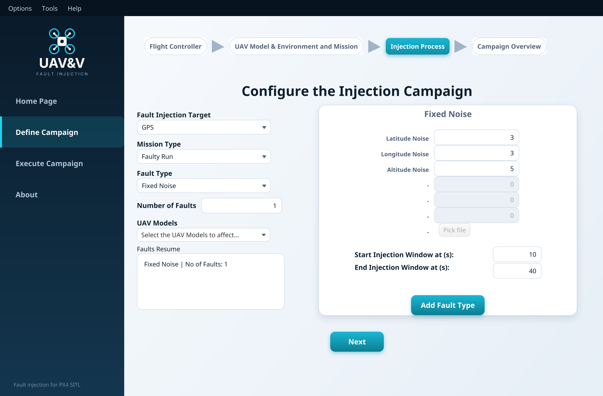

# UAV&V: seeded fault-injection toolkit for PX4 (anonymous artefact)

This repository accompanies a double-blind submission. It has two parts: the **toolkit** (campaign controller, simulator worlds,
mission plans, campaign examples, runners) and the **evaluation artefact** (PX4 patch, harness, analysis scripts, Gazebo replication kit
and per-experiment summary data). Raw flight logs are not included for size reasons.

## Layout
| Path | Content |
|---|---|
| `patch/` | `px4-1.13-uavv.patch` (7 files) against the upstream commit in `BASE_COMMIT.txt` |
| `toolkit/java-controller/` | JavaFX campaign controller (source only; JavaFX/JSch/etc. libraries are not bundled) |
| `toolkit/gui-theme/` | the visual-only patch that restyled the controller (see its README) |
| `docs/gui/` | screenshots and a short silent walkthrough of the controller |
| `toolkit/gazebo-worlds/`, `missions/`, `campaign-examples/` | Gazebo world files, QGroundControl `.plan` missions, example campaign CSV files |
| `toolkit/campaign-runners/` | `RunCampagin.py` (campaign CSV to `.fc` fault files), `RunMissions.py`, DroneKit mission script |
| `toolkit/px4-reference-files/` | the original PX4 files the patch started from, kept for reference |
| `experiments/` | headless harness (`runtrial*.py`, `campaign*.py`) and analysis scripts (see `experiments/INDEX.md`) |
| `gazebo/` | the harness running PX4 with Gazebo Classic 11 in Docker, and a jMAVSim-versus-Gazebo comparison |
| `injections/` | example fault-specification files (`Fault.fc`) |
| `data/` | summary tables of every experiment; `data/gazebo/` holds the Gazebo comparison |

Further documents: [DEPLOYMENT.md](DEPLOYMENT.md), [FAULT_CATALOGUE.md](FAULT_CATALOGUE.md), [CONTRIBUTING.md](CONTRIBUTING.md), [LICENSE](LICENSE).

## Graphical controller
The Java controller walks a user through four steps: choose the flight controller (PX4 SITL), add UAV models with their missions and the
Gazebo world, configure the injection (target, mission type, one of 21 predefined faults or a user-defined Python fault, parameters and
injection window), and review and generate the campaign. Execution, test campaigns and campaign import are reached from the home page.
Screenshots and a 20 s silent walkthrough are in [docs/gui](docs/gui/README.md); the walkthrough is assembled from screenshots and does not show a flight.

## Quick start (headless PX4 + jMAVSim)
1. Check out upstream PX4 at the commit in `patch/BASE_COMMIT.txt` (with submodules) and run `git apply patch/px4-1.13-uavv.patch`.
2. Prepare the paths described in [DEPLOYMENT.md](DEPLOYMENT.md) (the injector reads its fault file from a fixed path compiled into PX4).
3. One gold flight: `python3 experiments/runtrial.py --seed 1 --cfg gold --gold`; a faulty flight:
   `python3 experiments/runtrial.py --seed 1 --cfg FixedNoise --sub FixedNoise --values "5000, 5000, 0, 0"`.
4. A campaign: `python3 experiments/campaign.py 10`; scoring: `python3 experiments/analyze.py`.

## Gazebo
`gazebo/gz_setup.sh` builds the patched tree inside the `px4io/px4-dev-simulation-focal` image; `gazebo/campaign_gz.py N` runs the
Gazebo replication; `gazebo/compare_gz.py` compares it with the jMAVSim campaign (the paper's RQ5).

## Known limitations
- The injector reads the fault file from a hard-coded absolute path and the seed only labels a repetition; it does not replay injected values.
- Credentials, host names and institutional logos of the original development setup were removed; the controller's default machine is a
  documentation address (`192.0.2.10`) with the placeholder password `CHANGE_ME`. Edit `Machine.java` or the UI before use.
- The original controller drives remote machines through `sshpass`/`ssh` and Gazebo through `Tools/gazebo_sitl_multiple_run.sh`.
